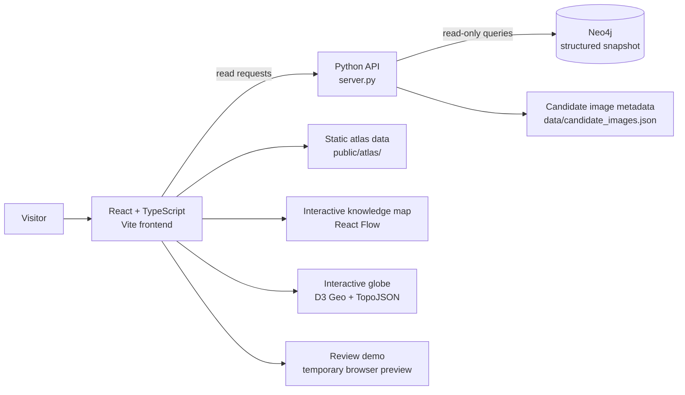

# EthnoTrace · Web application

**An interactive interface for exploring historical plant knowledge, proposed botanical identifications, and selected modern research.**

[Explore the live prototype](https://ethnotrace.vercel.app) · [Main project README](../README.md) · [Deployment guide](../DEPLOYMENT.md) · [Graph model](../neo4j/STRUCTURED.md)

> **Research prototype:** Plant identifications are hypotheses, historical claims are not proof of effectiveness, and model-assisted assessments require expert review. Nothing in the interface is medical advice.

## Technology at a glance

| Layer | Technologies | Role |
| --- | --- | --- |
| **Frontend** | TypeScript, React 19, HTML and CSS | Pages, search, filters and interactive research views. |
| **Build and styling** | Vite, Tailwind CSS 4, custom CSS | Development server, production build and visual styling. |
| **Visualizations** | React Flow (`@xyflow/react`), D3 Geo, TopoJSON | Interactive knowledge maps and a geographic atlas. |
| **Language support** | `pinyin-pro`, `opencc-js` | Romanization and Chinese text handling. |
| **Backend** | Python, standard-library HTTP server, official Neo4j Python driver | Read-only API between the browser and graph. |
| **Database** | Neo4j | Versioned historical records, botanical evidence, claims and research. |
| **Testing** | Python `unittest`, TypeScript, Playwright | API, type, build and browser checks. |
| **Hosting** | Vercel, Render, Neo4j Aura | Hosted frontend, API and graph, respectively. |

See [`package.json`](package.json), [`requirements.txt`](requirements.txt) and [`vite.config.ts`](vite.config.ts) for exact dependencies and settings. The scientific pipeline has its own inputs and requirements outside this folder.

## Contents

- [What the application provides](#what-the-application-provides)
- [How the pieces fit together](#how-the-pieces-fit-together)
- [Start locally](#start-locally)
- [API and data boundaries](#api-and-data-boundaries)
- [Candidate photographs and atlas data](#candidate-photographs-and-atlas-data)
- [Tests and checks](#tests-and-checks)
- [Folder guide](#folder-guide)

## What the application provides

| View | What users can explore |
| --- | --- |
| **Explore** | Search and filter historical entries by name, source and other available criteria. Entries with an A/B candidate are available in the catalogue; grouped results can combine entries sharing a preferred scientific name. |
| **Historical record** | Read the source context, passages and recorded historical names for an entry. |
| **Identification** | Inspect proposed plant candidates, A/B decisions, evidence, taxonomic resolutions, geography and description comparisons where recorded. Excluded X candidates can be shown explicitly. |
| **Claims & research** | Read extracted historical claims and quotations, proposed MeSH mappings, selected research and recorded assessments. Source links and excerpts are shown where available. |
| **Relationships & knowledge map** | Follow graph connections, select records, and pan, zoom or expand related evidence. Graph expansion is limited for usability; use the detail views for fuller lists. |
| **Atlas** | Explore the locations associated with historical books and recorded modern native ranges for proposed candidates. Modern ranges are context, not proof of a historical identification. |
| **Historical sources & about** | Read about the books, source material, methodology and project limitations. |
| **Expert review demo** | See explicitly labelled placeholder examples and preview a comment locally. Previewed comments are not submitted or saved and disappear when leaving the page or refreshing. They are not real expert reviews. |

The interface displays pipeline outputs and their provenance; it does not independently verify them. A historical entry may have multiple candidate identifications, and an accepted scientific name does not prove which plant an author meant. The [main README](../README.md) explains the sources, scientific pipeline, current graph counts and open issues.

## How the pieces fit together



The frontend is hosted on Vercel, the API on Render, and the deployed graph on Neo4j Aura. The atlas also uses static region and range files, while image metadata is stored separately from Neo4j. These components display the existing research outputs; they do not run the scientific pipeline or validate its findings.

## Start locally

### Prerequisites

- Node.js as specified in [`package.json`](package.json): **20.19 or newer within Node 20**, or **22.12 or newer**.
- Python and the Neo4j driver in [`requirements.txt`](requirements.txt).
- A reachable Neo4j database containing a compatible, completed structured build and its matching datasets. For local development, the commands below use `ethnotrace-clean`. See [graph setup](../neo4j/STRUCTURED.md) and [missing inputs](../MISSING_FILES.md).

Start Neo4j, then open two terminals from the repository root.

### 1. Start the Python API

```sh
cd Makeathon_UI
export NEO4J_URI='neo4j://127.0.0.1:7687'
export NEO4J_USER='neo4j'
export NEO4J_DATABASE='ethnotrace-clean'
read -s 'NEO4J_PASSWORD?Neo4j password: '; export NEO4J_PASSWORD; echo
../neo4j/.venv/bin/python -B server.py
```

The password prompt above uses macOS `zsh`. In `bash`, use `read -s -p 'Neo4j password: ' NEO4J_PASSWORD; export NEO4J_PASSWORD; echo`. Never commit credentials. If `neo4j/.venv` does not exist, create the Python environment and install the driver as described in [neo4j/README.md](../neo4j/README.md), or install the UI requirements into an appropriate environment. A Neo4j account restricted to read-only access is recommended.

The API defaults to `127.0.0.1:8787`. Check it at [http://127.0.0.1:8787/api/health](http://127.0.0.1:8787/api/health); the endpoint checks the database connection and reports the selected snapshot.

### 2. Start the frontend

```sh
cd Makeathon_UI
npm install
npm run dev
```

Open [http://127.0.0.1:8443](http://127.0.0.1:8443). By default, Vite proxies `/api` requests to the local API. If the API or database is unavailable, the application reports an error instead of replacing scientific records with mock data.

For production, configure the public `VITE_API_BASE_URL` at build time and the allowed frontend origins on the API. **Do not put Neo4j credentials in frontend variables.** See [DEPLOYMENT.md](../DEPLOYMENT.md) for the complete Vercel and Render configuration.

## API and data boundaries

The API uses parameterized, read-only Neo4j queries. It requires a completed structured snapshot, a shared claims/studies dataset and its matching full-unit dataset. If multiple completed builds exist, the API selects the latest dated build unless `ETHNOTRACE_SNAPSHOT` is set; ambiguous selection fails instead of silently mixing versions.

Some useful read-only endpoints:

| Endpoint | Purpose |
| --- | --- |
| `/api/health` | Database health and selected snapshot. |
| `/api/entries` | Search, filter and paginate historical entries; `grouped=1` requests grouped results. |
| `/api/entries/<id>` | Historical entry, names, candidate identifications and claims. |
| `/api/entries/<id>/evidence` | Paginated evidence records. |
| `/api/entries/<id>/studies` | Selected linked research and assessments. |
| `/api/candidates/<id>`, `/api/claims/<id>` | Candidate or claim details. |
| `/api/facets`, `/api/overview`, `/api/names` | Filter values, knowledge-map overview and search names. |
| `/api/reviews` | Generated demonstration examples; review submission through the API is disabled. |

Catalogue filters operate at the **entry level**: different candidates or claims within one entry can satisfy different filters. Candidate evidence and study assessments are paginated; entry details are limited to 200 candidates and 200 claims. Unlinked entry evidence is retained without assigning it to a candidate.

## Candidate photographs and atlas data

Candidate photographs are illustrations of a proposed modern plant, not proof of historical identity. When available, the interface displays creator, licence and source links. Metadata is stored in [`data/candidate_images.json`](data/candidate_images.json), separate from Neo4j; the interface uses a fallback when an image is unavailable.

The GBIF collector requires an exact accepted scientific-name match, a matching occurrence taxon key, HTTPS media, an individual creator and an accepted licence. It inspects a limited sample of occurrences, so a missing image does not prove no suitable image exists. A separate Wikidata/Wikimedia collector is also provided. Review images and their licences before reuse.

From `Makeathon_UI/`, check 20 names or resume the full A/B lookup:

```sh
python3 collect_candidate_images.py --limit 20
python3 collect_candidate_images.py --limit 0
```

The atlas uses [`public/atlas/`](public/atlas/) region outlines and range data. [`export_atlas_ranges.py`](export_atlas_ranges.py) prepares the range file from available geography outputs. Source and licence context is documented in [DATA_SOURCES.md](../DATA_SOURCES.md).

## Tests and checks

From `Makeathon_UI/`:

```sh
# Production build and TypeScript checks
npm run build
npx tsc --noEmit

# Local API tests; no live graph required for deployment tests
../neo4j/.venv/bin/python -B -m unittest discover -s tests -p 'test_deployment.py' -v

# Optional: API integration tests against a running graph
ETHNOTRACE_TEST_LIVE=1 ../neo4j/.venv/bin/python -B -m unittest discover -s tests -v

# Browser checks against the running local frontend and API
npx playwright test tests/ui.spec.ts
```

On a new machine, install the browser with `npx playwright install chromium` first. The live integration checks include Carrots, Dioscorides chapters 1.1, 1.3 and 1.117, Bifoil, MeSH mappings, linked research and LSJ provenance. They use read-only database queries. Passing software checks does not independently validate botanical or medical conclusions.

## Folder guide

| Path | Contents |
| --- | --- |
| [`src/`](src/README.md) | React components, views, styles and frontend helpers. |
| [`src/LiveApp.tsx`](src/LiveApp.tsx) | Data-connected application. |
| [`src/App.tsx`](src/App.tsx) | Original Figma prototype, kept as a reference. |
| [`src/Atlas.tsx`](src/Atlas.tsx) | Interactive atlas. |
| [`src/PeerReview.tsx`](src/PeerReview.tsx) | Demonstration-only review interface. |
| [`server.py`](server.py) | Read-only Neo4j-backed API. |
| [`public/`](public/README.md) | Static assets, including atlas files. |
| [`data/`](data/README.md) | Local data used by the UI, including image metadata. |
| [`tests/`](tests/README.md) | API, integration and browser tests. |
| [`collect_candidate_images.py`](collect_candidate_images.py), [`collect_wikidata_images.py`](collect_wikidata_images.py) | Optional candidate-image collection utilities. |
| [`export_atlas_ranges.py`](export_atlas_ranges.py) | Optional atlas range-data preparation. |

For scientific methods, source licences and reproducibility beyond the application, start with the [main project README](../README.md).
