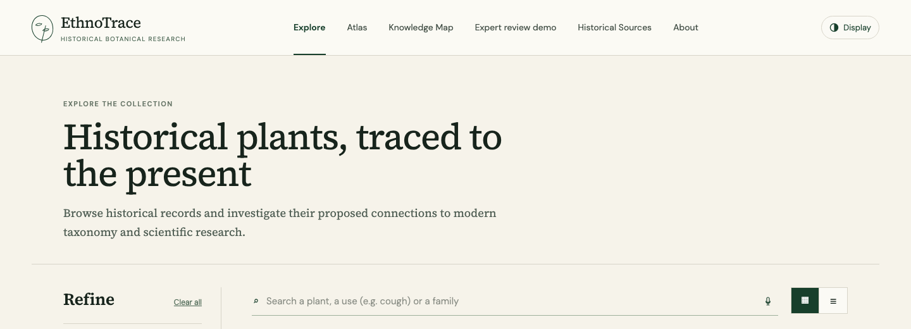
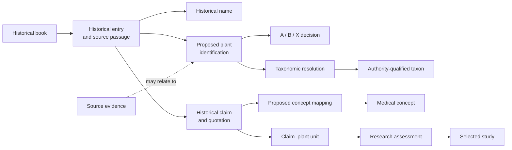
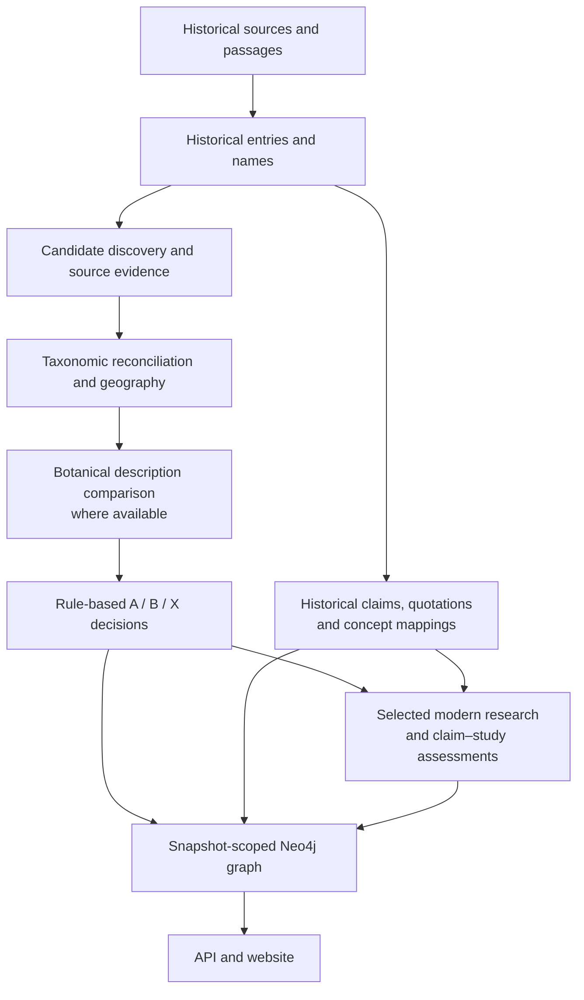

# EthnoTrace

EthnoTrace connects historical medicinal texts with proposed botanical identifications, historical claims and selected modern research. It preserves source evidence and uncertainty so the connections can be inspected. Plant identifications are hypotheses; historical claims and AI-assisted assessments are not proof of medical effectiveness.

**Explore the prototype:** [ethnotrace.vercel.app](https://ethnotrace.vercel.app) · [API health and selected snapshot](https://ethnotrace-api.onrender.com/api/health)

## Try EthnoTrace in 60 seconds

1. [Open the catalogue](https://ethnotrace.vercel.app), search **Carrots**, and open Culpeper's entry.
2. In **Identification**, inspect the proposed modern plant and the evidence behind it.
3. In **Claims & Research**, follow the historical claim about menstrual flow to a related research record and its assessment.
4. Open **Relationships** or the **Knowledge Map** to explore connections. See the [worked evidence trail](#a-real-evidence-trail-culpepers-carrots) below for the source records.

The application currently navigates by in-page state; there is no verified direct link to an individual entry. Search for Carrots after opening the catalogue.

## Contents

- [Try the demo](#try-ethnotrace-in-60-seconds)
- [Project overview](#what-ethnotrace-does)
- [Reproducibility](#reproducibility-at-a-glance)
- [Real evidence trail](#a-real-evidence-trail-culpepers-carrots)
- [Limitations & availability](#limitations--availability)
- [Results and Neo4j graph](#current-graph-verified-snapshot-counts)
- [Evaluation and validation status](#evaluation-and-validation-status)
- [Pipeline and implementation](#pipeline-from-historical-texts-to-the-interface)
- [Setup and repository guide](#start-here)
- [Historical works and editions](#books-and-editions)
- [Generative AI](#use-of-generative-ai) · [Licence](#licence) · [Open issues](#open-issues)

## What EthnoTrace does

EthnoTrace brings historical medicinal texts, possible modern botanical identifications, medicinal claims, medical terminology and selected modern research into a connected research interface. Users can search a historical entry, read its source passage, inspect candidate plants and their evidence, explore claims and research assessments, and follow relationships in an interactive knowledge map. The atlas provides geographic context for proposed identifications.

The unit of exploration is a **historical entry**, not necessarily a uniquely identified plant. A single entry may have several candidates or none, and entries can describe non-plant material. A modern scientific name is a proposed identification; taxonomic acceptance does not establish that the historical author meant that species. A historical claim records an author's statement, not evidence of therapeutic benefit.

The expert-review feature is an explicitly labelled **interface demonstration**. Its sample comments are placeholders, not expert reviews. A visitor can preview a comment locally, but it is not submitted or saved and disappears on leaving the page or refreshing.

## Limitations & availability

**Expert review needed:** We are not domain experts in botany, historical medicine, or clinical research and are not in a position to independently validate these results. EthnoTrace is a research prototype designed to make sources and proposed connections traceable for qualified experts to examine. Its outputs should not be used as medical advice or treated as validated findings.

**Neo4j hosting:** The graph is hosted for two weeks starting **7 November 2026**, until **21 November 2026**. If access is needed afterwards, contact the project team to request a database dump. The dump is **over 1.2 GB**.

**Reproducibility and coverage:** Some inputs, API caches and model replies are distributed separately; see [MISSING_FILES.md](MISSING_FILES.md). Historical extraction, candidate identification and claim–study assessments can contain errors. The Stage 3 pilot review is provisional; see [open issues](#open-issues).

## Reproducibility at a glance

| Question | Current answer |
| --- | --- |
| **Can I try the website?** | Use the [hosted demo](https://ethnotrace.vercel.app) while its services are available. To run the full application locally, you need a compatible, populated Neo4j graph; see the [UI setup](Makeathon_UI/README.md). |
| **Can I recreate the graph from Git alone?** | Not completely. Core code and many processed outputs are tracked, but some original downloads, source outputs, model replies, caches and full unit files are distributed separately. See [MISSING_FILES.md](MISSING_FILES.md) and [structured import requirements](neo4j/STRUCTURED.md). |
| **Can I reproduce the results?** | Saved tracked outputs can be inspected, and some deterministic downstream stages can be rerun when their inputs are present. Other stages need the separately distributed files, external services or model access; repeated AI calls need not produce identical answers. Check [MISSING_FILES.md](MISSING_FILES.md) for stage-specific requirements and overwrite risks. |
| **Can I run software tests?** | With Python 3.10 or newer, run `python3.10 -B tests/run_tests.py` from the repository root. A successful run exits with status 0 and ends in `OK`; see [tests/README.md](tests/README.md). Passing tests do not establish scientific correctness. |
| **Can I obtain the graph?** | The team can provide a dump larger than 1.2 GB on request. Contact the project team; no public dump download is currently listed. Import requires a compatible Neo4j environment and adequate storage. |

## Current graph: verified snapshot counts

The table below comes from the live application's read-only [`/api/facets`](https://ethnotrace-api.onrender.com/api/facets) response, checked on **8 November 2026**. The selected snapshot reported by `/api/health` was `cbb213486fd7894eb8a0c7e900136ded38e931854119c297690d1af7fd6e9cdc`. Counts are for this snapshot and the claims dataset selected by the API, not all snapshots in the database. They can change after a rebuild.

| Historical source | Historical entries | Entries with at least one A/B candidate | Linked historical claims |
| --- | ---: | ---: | ---: |
| Culpeper | 327 | 275 | 5,202 |
| Dioscorides | 823 | 401 | 3,832 |
| Shennong | 359 | 199 | 1,419 |
| **Total** | **1,509** | **875** | **10,453** |

These are counts of entries and extracted claim records, not counts of unique species, medically effective remedies or independently validated identifications. An entry can have multiple candidates and claims. An A/B candidate is a pipeline classification, not expert confirmation. Claims include historical interpretations, potentially including non-medical categories; they should not all be described as validated medicinal effects.

### What is represented in Neo4j

The structured graph contains domain records and the relationships needed to trace them, including:

| Graph record | What it represents |
| --- | --- |
| `Book`, `HistoricalEntry`, `HistoricalName` | Editions, historical entries, names and source context. |
| `IdentificationHypothesis`, `EligibilityDecision` | Proposed botanical candidates and their A/B/X decisions, reasons and caveats. |
| `EvidenceRecord`, `EvidenceSource` | Evidence rows, sources, lineages and links to candidates where they can be made unambiguously. |
| `TaxonomicResolution`, `Taxon` | Authority-specific name resolutions and qualified taxon identities; accepted taxonomy is not proof of historical identity. |
| `DescriptionComparison`, `CandidateDescription`, `DescriptionScore` | Recorded botanical-description comparisons, feature scores and supporting quotations where available. |
| `HistoricalClaim`, `ConceptMapping`, `MedicalConcept` | Extracted claims, their quotations and proposed medical terminology mappings, including MeSH. |
| `ClaimLink`, `ClaimPlantUnit`, `FullUnitRecord` | Inferred cross-book groupings and claim–plant source units; groupings do not prove remedies are equivalent. |
| `Study`, `EvidenceAssessment`, `EvidenceExcerpt` | Selected research records, claim–study assessments and recorded supporting excerpts. |
| `StructuredBuild`, `DatasetImport`, `SourceDocument`, `SourceValue` | Build and dataset provenance, source-file references and structured preservation of imported source values. |

Not every entry has every type of record. Unmatched or ambiguous evidence and hidden candidates are retained rather than arbitrarily assigned. The graph preserves structured source values, while raw API caches, complete conversations and publisher texts may remain in external files. See [the structured graph documentation](neo4j/STRUCTURED.md) for details and [the graph model](neo4j/MODEL.md) for relationships.

### How the knowledge graph connects evidence

This simplified diagram shows possible connections. A historical entry can have multiple candidates and claims, and not every claim has a linked study. A connection or assessment is not proof of a plant's historical identity or a remedy's effectiveness.

The diagram is an overview, not a complete schema or a statement of relationship direction. Consult [STRUCTURED.md](neo4j/STRUCTURED.md) and [MODEL.md](neo4j/MODEL.md) for implementation details and provenance.

### Recount the graph

The public [`/api/facets`](https://ethnotrace-api.onrender.com/api/facets) endpoint provides the per-book counts above. For the snapshot-scoped Neo4j query and instructions on choosing the correct dataset, see [Recount the graph](neo4j/STRUCTURED.md#recount-the-graph). Counts across snapshots or overlapping source records should not be summed indiscriminately.

## A real evidence trail: Culpeper's Carrots

This example follows actual saved records. It illustrates traceability and the distinction between a historical use and a related study—not validation of a remedy.

1. **Historical entry and candidate.** In the processed Culpeper entry “Carrots,” the pipeline lists *Daucus carota* L. as an A-tier candidate. Its [eligibility record](matching/culpeper/eligibility.json#L54725) records the rules, evidence lineages, geography and description-comparison result. An A decision is a pipeline classification, not independent proof of identity.
2. **Historical quotation and claim.** The [claim record](claims/culpeper/claims.json#L26664) `culpeper:carrots:c05` preserves the words “women’s courses” and the extracted interpretation “Promotes menstrual flow.” It proposes MeSH mappings for menstruation and menstruation-inducing agents; those mappings are interpretations of historical language.
3. **Selected modern research.** The saved [study record](stage3/studies/shared/studies.jsonl#L4101) links to [PMID 38202401](https://pubmed.ncbi.nlm.nih.gov/38202401/), a phytochemical and pharmacological review of wild carrot.
4. **Assessment and caveat.** The [claim–study assessment](stage3/assessments/shared/assessments.jsonl#L163) records that source as **not relevant** to this particular claim, with no finding, and marks the assessment **unreviewed**. It should not be presented as evidence that the historical use works.

[Open the live catalogue](https://ethnotrace.vercel.app) and search **Carrots**. The corresponding [entry API record](https://ethnotrace-api.onrender.com/api/entries/ea78aac5ec97168a8980a4ce2907a7c88635546c185c4ed0e2ced145af6e8dfa) is tied to the selected snapshot and may change after a rebuild.

## Evaluation and validation status

Three different kinds of checking should not be confused:

- **Software tests** exercise implementation behavior, such as eligibility rules, API responses, graph consistency, type checking and browser flows. They are not botanical or medical validation. See [offline tests](tests/README.md) and [UI checks](Makeathon_UI/README.md#tests-and-checks).
- **Automated data checks** compare quotations or excerpts with available source text, reconcile names against taxonomic sources, and apply documented rules. A successful match or rule execution cannot establish that an interpretation is correct.
- **Independent scientific validation** requires qualified people to review historical identities, translations, claims and research assessments against their sources. That work remains incomplete.

We ran an exploratory test of the **botanical description-comparison step** against expert scores from Lardos et al. (2024). The sample contained **15 deliberately stratified candidates**—five from each expert category of strong, moderate and weak—with 89 feature details judged by the experts. This is a small selected sample, not a representative accuracy test of the full pipeline.

| Reported run | Historical input | Agreement on final description-fit category | Agreement on feature scores | Cohen's kappa for feature scores |
| --- | --- | ---: | ---: | ---: |
| `flash38_en` | The paper's English historical details | 11/15 (73%) | 62/89 (70%) | 0.46 |
| `flash38_gr` | Wellmann's Greek chapters | 10/15 (67%) | 51/89 (57%) | 0.28 |

These numbers describe agreement with expert **description-fit scores for supplied candidates**. They do **not** measure how often EthnoTrace selects the correct historical species, validate all extracted claims, or establish medical effectiveness. The English and Greek runs assess different inputs; the Greek task additionally requires locating features in the historical text. See the [full results, sampling method and limitations](description_sources/paper_test/RESULTS.md) for the other models and disagreements.

The [Stage 3 pilot review](stage3/review/README.md) is provisional: its review procedure was not recorded, so its scores must not be presented as validated accuracy. Independent domain-expert review and a larger, documented evaluation remain future work. Software tests check implementation behavior; they do not independently validate historical or medical findings.

## Pipeline: from historical texts to the interface

The exact inputs and coverage vary by book and stage. Later steps use the saved outputs of earlier steps; the diagram does not imply that every historical entry was assessed at every stage.

### Pipeline guides

1. **[Historical texts](historical_texts/README.md):** Extract entries, passages and historical names from each processed edition. The [books and editions](#books-and-editions) section distinguishes original periods from later editions.
2. **[Candidate discovery and matching](matching/README.md):** Search common-name databases and historical references, preserve source evidence and account for related source lineages. Reconcile names against WFO, WCVP and other authorities, and consider geographic context.
3. **[Description comparison](description_sources/README.md) and [eligibility rules](matching/ELIGIBILITY_RULES.md):** Compare available botanical features and classify candidates as **A** (stronger criteria met), **B** (possible with caveats) or **X** (not shown as A/B, retained in the data). The current Shennong pipeline has no botanical-description comparison. These are pipeline decisions, not expert-confirmed identities.
4. **[Historical claims](claims/README.md):** Extract interpretations with source quotations and propose medical-concept mappings. Cross-book groupings are inferred connections, not proof of equivalent remedies.
5. **[Modern research assessments](stage3/README.md):** Retrieve selected sources and apply AI-assisted extraction and predefined rules to compare them with selected claim–plant units. Coverage is incomplete and assessments require review.
6. **[Neo4j graph](neo4j/STRUCTURED.md) and [web application](Makeathon_UI/README.md):** Import snapshot-scoped records and expose them through the read-only API, catalogue, atlas and knowledge map.

## Start here

- [Run the website and local API](Makeathon_UI/README.md) — setup, database connection and frontend.
- [Prepare Vercel and Render deployment](DEPLOYMENT.md) — hosted configuration and limitations.
- [Understand the pipeline and files](#repository-guide) — follow the data through the project.
- [Run the offline tests](tests/README.md) — Python 3.10 or newer.
- [Inspect the graph and import process](neo4j/README.md) — schema, snapshots and Cypher.
- [Check missing downloads and caches](MISSING_FILES.md) — some inputs are distributed separately and not in Git.
- [Review data sources and licences](DATA_SOURCES.md).

## Repository guide

| Folder | Purpose |
| --- | --- |
| [historical_texts](historical_texts/README.md) | Source texts, extracted entries and historical reference lookups. |
| [common_name_sources](common_name_sources/README.md) | Common-name and historical-name candidate sources. |
| [scientific_name_sources](scientific_name_sources/README.md) | Taxonomic authority lookups and reconciliation inputs. |
| [reference_sources](reference_sources/README.md) | Dictionary, historical and medical terminology reference material. |
| [matching](matching/README.md) | Candidate aggregation, reconciliation, geography and eligibility results. |
| [description_sources](description_sources/README.md) | Modern descriptions and historical-to-modern comparisons. |
| [claims](claims/README.md) | Historical medicinal claims, quotations and MeSH mappings. |
| [stage3](stage3/README.md) | Selected modern study retrieval and claim–study assessments. |
| [neo4j](neo4j/README.md) | Versioned graph schema, importers and queries. |
| [Makeathon_UI](Makeathon_UI/README.md) | Website, local API and interface tests. |
| [tests](tests/README.md) | Offline pipeline and graph contract tests. |
| [reports](reports/README.md) | Space for local investigation reports. |

## Use of generative AI

Generative AI assisted the project. **OpenAI Codex and Anthropic Claude** were used during development, including work on code, documentation and reviews. **Google Gemini** was used in parts of the research pipeline, including extraction, translation and comparison tasks. AI-assisted reviews and outputs are not a substitute for independent domain-expert validation.

## Licence

The project's original software is available under the [MIT License](LICENSE). This does not change the rights or terms of third-party material, including historical texts and transcriptions, datasets and derived data, photographs, icons, or software dependencies. Their respective licences and attribution requirements continue to apply; see [DATA_SOURCES.md](DATA_SOURCES.md) and any notices provided with the material. Check the applicable source terms before redistributing data or assets.

## Books and editions

The historical period of a work and the edition processed by the pipeline are different:

| Historical work | Period of the work | Edition or transcription processed |
| --- | --- | --- |
| Nicholas Culpeper, *The Complete Herbal* | Seventeenth century; associated with 1653. | [Project Gutenberg eBook #49513](https://www.gutenberg.org/ebooks/49513), a digital transcription of the **1850 Thomas Kelly edition**. The processed text is not a direct transcription of the 1653 edition. |
| Dioscorides, *De materia medica* | First century CE. | The **First1KGreek TEI transcription of Max Wellmann's Greek edition**, published across 1906–1914. |
| *Shennong Bencao Jing* | Traditionally associated with the Han period, approximately first–second century CE. | The **1799 reconstruction by Sun Xingyan and Sun Fengyi**, from the specified Chinese Wikisource transcription; it is a later reconstruction rather than the original historical text. Added to this project on 6 November 2026. |

The books share the broader workflow, with book-specific sources and limitations; see [data sources](DATA_SOURCES.md) and [eligibility rules](matching/ELIGIBILITY_RULES.md).

## Open issues
- **Shennong: 2 "direct" Stage 3 results need a person.** Grape juice for strength (an athletes' trial, result
  inconclusive) and red peony root for abdominal pain (a pancreatitis trial: a related condition, not the
  same). Left as the model answered.
- **Stage 3 pilot review is provisional.** Stage 3 assessments remain provisional and require independent human review before their scientific conclusions can be validated. See [the review record](stage3/review/README.md).
- **Stage 3 batch size and repeat runs.** Later sets use 32 pairs per prompt; this was not tested against
  the pilot's 8. Each prompt version was run once; repeated runs (ablation) were not done for time.
  See `stage3/EVIDENCE_RULES.md`.
