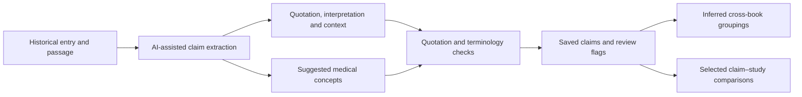

# Historical claims and medical concepts

A **historical claim** is an extracted interpretation of what a historical source says—for example, a reported use, property or other statement. It is not proof of medical effectiveness. This folder preserves source quotations, structured interpretations and proposed medical-concept mappings so a reader can inspect the connection.

[Main project](../README.md) · [Claims method](CLAIMS_METHOD.md) · [Medical data sources](../DATA_SOURCES.md) · [Missing inputs](../MISSING_FILES.md)

## How it works

1. [extract_claims.py](extract_claims.py) prepares and imports model-assisted extractions. Depending on the record, fields can include a quote, translation, plant part, preparation, route, claim wording, relation and kind.
2. Proposed concepts are checked against medical terminology such as MeSH. Other scripts support terminology mapping and cross-checks; see [CLAIMS_METHOD.md](CLAIMS_METHOD.md). A `close` or `broad` match is not an exact historical equivalent.
3. [link_claims.py](link_claims.py) creates [links.json](links.json) and [graph exports](graph/README.md) from recorded plant and concept criteria. These are inferred groupings, not proof that two authors described equivalent remedies.
4. Selected claim–plant combinations feed [Stage 3](../stage3/README.md), where they may be compared with retrieved research.

## A real saved example

In [Culpeper's claims](culpeper/claims.json), `culpeper:carrots:c02` retains the quotation **“break wind”**, the interpretation “Expels intestinal gas” and a proposed MeSH mapping to Flatulence (`D005414`). This is an extracted historical interpretation, not a verified treatment claim. Other claims can have no mapping or an approximate mapping.

## Files

| Path | Contents |
| --- | --- |
| [Culpeper](culpeper/README.md), [Dioscorides](dioscorides/README.md), [Shennong](shennong/README.md) | Book-specific `claims.json`, review samples and available cross-checks. |
| [historical_terms.csv](historical_terms.csv) | Recorded historical-term mapping work. |
| [review_results.json](review_results.json) | Saved sample-review summary; verify review provenance before using it as human validation. |
| [links.json](links.json), [graph/](graph/README.md) | Inferred groups and graph exports. |

## Limits and review

The source quotation remains the evidence to inspect: a substring check does not prove the extraction or translation is correct. The claim files include more than medical categories, and MeSH is a proposed mapping, not a diagnosis. The documented Culpeper and Dioscorides sample-review scores need review provenance to be confirmed; Shennong's Claude-only review is not human validation. Some prompts, replies and caches are external to Git; see [MISSING_FILES.md](../MISSING_FILES.md).
