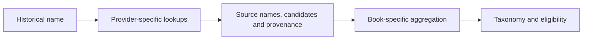

# Common-name sources · Candidate discovery

Historical and common names are a starting point for finding **possible** modern scientific names. A match provides a source record to inspect; it is not proof that a historical author meant that species.

## Providers

| Folder | Role in the pipeline |
| --- | --- |
| [GBIF](gbif/README.md) | Common-name and taxon records. |
| [Wikidata](wikidata/README.md) | Labels, aliases and linked taxon information. |
| [ChecklistBank](checklistbank/README.md) | Name records from multiple checklists and datasets. |
| [iNaturalist](inaturalist/README.md) | Common-name and taxon records. |
| [TaxTree](taxtree/README.md) | Access to NCBI taxonomy-related names. |
| [Dr. Duke's](drduke/README.md) | Recorded plant names and ethnobotanical source data. |

Available providers and source files vary by book. Results feed the per-book aggregation in [matching](../matching/README.md); historical dictionaries are maintained separately under [reference sources](../reference_sources/README.md).

## Why provenance matters

Two records can be copies of the same underlying dataset. The eligibility rules group certain related sources into lineages to reduce double-counting, but source independence still needs scrutiny. Exact spelling is evidence of a name match, not automatic proof of historical identity. Source-specific terms and attribution are listed in [DATA_SOURCES.md](../DATA_SOURCES.md); raw downloads and caches may require the separate inputs described in [MISSING_FILES.md](../MISSING_FILES.md).
