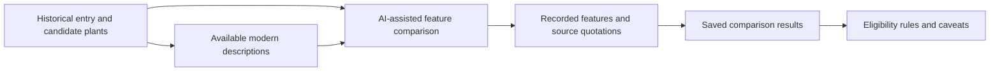

# Botanical description comparison

A historical name can refer to several possible plants. This stage helps compare **features recorded in a historical description** with available modern descriptions of candidate species. It supports the identification workflow; it does not independently establish a plant's identity.

## Components

| Path | Purpose |
| --- | --- |
| [targets.py](targets.py) | Prepare targets for description lookups. |
| [bhl/](bhl/README.md) | Biodiversity Heritage Library description-source workflow. |
| [wikipedia/](wikipedia/README.md) | Wikipedia description-source workflow. |
| [check/](check/README.md) | Prompt preparation, imported responses and comparison results. |
| [paper_test/](paper_test/README.md) | Model-method testing against available research material. |

The comparison can record features such as leaves, roots, flowers, habitat or timing, together with available supporting quotations and scores. [matching/eligibility.py](../matching/eligibility.py) uses recorded comparison states as one input to classification; see [eligibility rules](../matching/ELIGIBILITY_RULES.md).

## Interpretation and limits

A quotation check can establish that text appears in a source; it does not establish that the model's feature interpretation is correct. Missing or insufficient description data is not proof of a poor match. Coverage varies by entry and candidate, and the current Shennong classic has no botanical-description comparison. Model-method test results are specific to their setup and do not validate every identification. Some descriptions, cached responses and prompts require the separate inputs in [MISSING_FILES.md](../MISSING_FILES.md).
