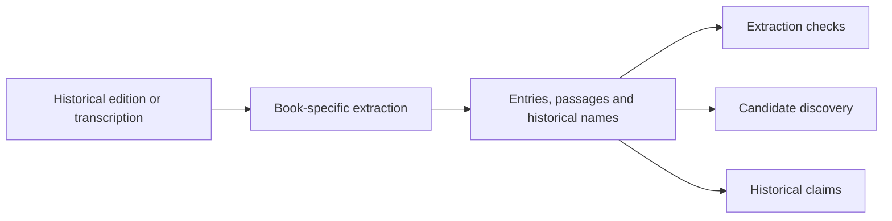

# Historical texts and extraction

This folder is the starting point for EthnoTrace. It contains the source texts, book-specific extraction scripts, historical names, and supporting reference lookups. The output is a collection of **historical entries**: passages and names from the sources, not verified modern species.

[Main project](../README.md) · [Data sources and licences](../DATA_SOURCES.md) · [Missing inputs](../MISSING_FILES.md)

## Sources and editions

| Work | Historical context | Processed source | Outputs and code |
| --- | --- | --- | --- |
| **Culpeper, The Complete Herbal** | Seventeenth-century English herbal, associated with 1653. | Project Gutenberg #49513, a transcription of the **1850 Thomas Kelly edition**. | [Culpeper guide](culpeper/README.md), `culpeper.html`, `extract_herbs.py`, `herbs.json`, `validate_herbs.py`. |
| **Dioscorides, De materia medica** | First-century Greek work. | First1KGreek TEI transcription of **Max Wellmann's 1906–1914 edition**. | [Dioscorides guide](dioscorides/README.md), `extract_wellmann.py`, `chapters.json`, `validate_wellmann.py`, and LSJ/Lewis & Short lookups. |
| **Shennong Bencao Jing** | Tradition associated with the Han period; the original work does not survive unchanged. | Chinese Wikisource transcription of **Sun Xingyan and Sun Fengyi's 1799 reconstruction**. | [Shennong guide](shennong/README.md), `extract_sun.py`, `entries.json`, source checks and Bretschneider reference lookups. |

The dates of later editions are not the dates of the original works. See [DATA_SOURCES.md](../DATA_SOURCES.md) for attribution and source-specific terms.

## What passes downstream

- Entry identifiers, book or chapter references, headings or historical names, and source passages are retained where recorded.
- The [matching pipeline](../matching/README.md) searches historical names for possible botanical candidates; the [claims pipeline](../claims/README.md) extracts historical statements and quotations.
- Historical dictionaries and Bretschneider provide additional *source assertions*. Their identifications are evidence to evaluate, not automatically correct plant identities.

## Important limitations

Extraction can mistake ordinary words or partial phrases for headwords, and chapter structure or later editorial material can complicate interpretation. Correctly copying a passage does not prove its extracted name is correct. Ancient-language translations and identifications require expert review. Some downloaded inputs and model responses are distributed separately; see [MISSING_FILES.md](../MISSING_FILES.md). Consult each book's guide and the original source before interpreting an entry.
