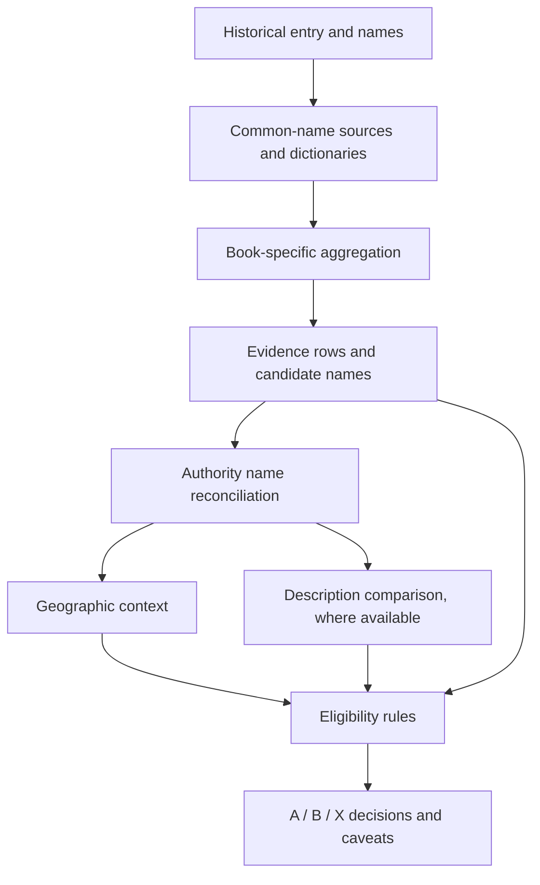

# Matching, botanical evidence and eligibility

This stage asks: **which modern plants might a historical entry refer to, and what evidence supports each possibility?** It collects candidate names and source records, checks taxonomy and geography, and records a rules-based A/B/X decision. A candidate remains a hypothesis, even if a taxonomic authority accepts its name.

[Main project](../README.md) · [Matching rules](MATCHING_RULES.md) · [Eligibility rules](ELIGIBILITY_RULES.md) · [Missing inputs](../MISSING_FILES.md)

## What happens at each step

1. **Discover names.** Common-name databases and historical references propose scientific names for names recorded in the texts. See [common-name sources](../common_name_sources/README.md) and [reference sources](../reference_sources/README.md).
2. **Aggregate evidence.** Each book's `aggregate.py` records source rows, matches and candidate names. Source lineage and the kind of match matter: related databases can share underlying data.
3. **Reconcile names.** [resolve_scientific.py](resolve_scientific.py) uses outputs from WFO, WCVP, Global Names and IPNI to record scientific-name resolutions, including disagreements. Taxonomic acceptance answers a naming question; it does not confirm historical identity.
4. **Add context.** [geography.py](geography.py) considers distributions against the historical context. The [description comparison](../description_sources/README.md), where available, compares recorded features using AI-assisted extraction and source quotations.
5. **Classify candidates.** [eligibility.py](eligibility.py) applies documented rules to the available evidence. **A** meets stronger criteria; **B** remains possible with caveats; **X** does not meet the current requirements for A/B presentation and is retained with its reason.

## Files by book

| Output | What to inspect |
| --- | --- |
| `evidence.jsonl` | Source evidence rows and matching context. |
| `candidates.json` | Aggregated candidate names for entries. |
| `scientific_name_candidates.json`, `scientific_name_queries.jsonl` | Scientific-name inputs and query records. |
| `scientific_names_resolved.json`, `herb_candidates_resolved.json` | Authority resolutions and candidate-level results. |
| `geography.json` | Recorded geographic checks and context. |
| `eligibility.json` | A/B/X results, rules, reasons and caveats. |

Browse the [Culpeper](culpeper/README.md), [Dioscorides](dioscorides/README.md) and [Shennong](shennong/README.md) outputs. Availability and schema vary; consult the actual files and [missing-file guide](../MISSING_FILES.md) before running a stage. Pipeline commands can rewrite outputs: back them up first.

## Interpret responsibly

A strong name match, modern distribution or accepted scientific name cannot prove what a historical author meant. Source records can be related, missing, ambiguous or based on historical scholarship that itself needs checking. Description comparisons are not expert botanical validation, and the current Shennong classic has no botanical description comparison. For exact thresholds, precedence, lineage grouping and caveats, use [ELIGIBILITY_RULES.md](ELIGIBILITY_RULES.md), not this summary.
