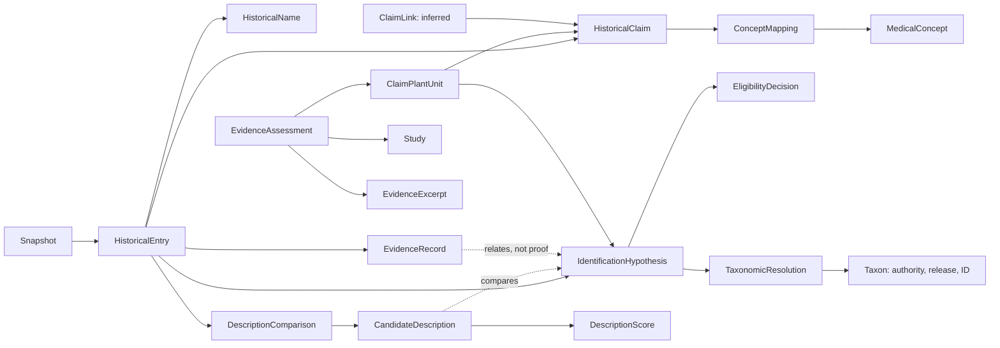

# EthnoTrace graph model and display contract

The database holds historical statements and evidence, not proven medical recommendations. Source data remains authoritative. `raw_json` preserves nested records without implying that they were validated. Frequently displayed fields can be materialized as scalar properties; unknown and not-applicable values must remain distinct according to the source contract.

## Records and UI fields

| Label | Information to display / preserve | Scope |
|---|---|---|
| `PipelineSnapshot` | input hashes, preparation version, pipeline/run provenance where available | immutable snapshot |
| `Book`, `HistoricalEntry`, `HistoricalName` | edition, author, entry/chapter/page, original text and names, original quotation, name layer | snapshot |
| `IdentificationHypothesis` | original candidate names, accepted name, rank, family, authority IDs, uncertainty | snapshot and historical entry |
| `EvidenceRecord`, `EvidenceSource` | source name, record/citation/URL if provided, original and normalized names, grade, lineage, match, original record | evidence snapshot; source name shared |
| `TaxonomicResolution`, `Taxon` | original name, resolution rule, WFO/WCVP opinion, accepted identifier, authority and release; disagreement remains visible | resolution snapshot; taxon authority + release + ID |
| `EligibilityDecision` | A/B/X, rule IDs, caveats, reasons, pipeline snapshot | snapshot and hypothesis |
| `DescriptionComparison`, `CandidateDescription`, `DescriptionScore` | model/version, candidate verdict/congruence, original historical quotes, individual feature scores, source labels, reasons and raw result | snapshot and entry; candidate link only when unique |
| `HistoricalClaim` | source claim ID, book/edition, chapter, exact quotation and language, interpretation, plant part, preparation and route, extraction method/review and raw provenance | snapshot and entry |
| `MedicalConcept`, `ConceptMapping` | namespace and concept ID/version; exact/close/uncertain match, method, evidence and review | concept vocabulary release; mapping snapshot |
| `ClaimLink` | source link ID, method, confidence, caveat and provenance; a claim link is an inference, not equivalence | snapshot and one or more grouped claims |
| `ClaimPlantUnit` | one claim × one proposed plant for one entry; include the identification decision and uncertainty when displaying | snapshot |
| `Study` | publication IDs, title, source, date, study type, text locator/hash and license | source identity/version; not an assessment |
| `EvidenceAssessment` | one unit × one study; relevance, study design, finding, applicability, match/mismatch/unknown by species, condition, action, part, preparation and route; model/version, rules and review | snapshot and unit × study × assessment version |
| `EvidenceExcerpt` | exact passage or structured field, source locator, offsets, validation status | snapshot and assessment |

For nested source data such as model settings, compatibility objects or raw API responses, preserve the complete original as JSON text and materialize documented, independently verified scalar display fields. Neo4j properties do not directly support arbitrary nested maps.

## Meaning and provenance

- `Taxon` nodes are keyed by authority + exact release + accepted authority ID. WFO and WCVP remain separate, even when names agree; no automatic `SAME_AS` is asserted. Global Names results without accepted authority IDs are retained as resolutions, not assigned invented IDs.
- Each `RESOLVES_TO` relationship preserves the authority, accepted name and rule for that particular resolution. A `Taxon` joins historical candidates only as an authority-record identity, never as proof of a historical identification.
- `RELATES_TO_HYPOTHESIS` represents a uniquely matched normalized node. It is **not** an assertion that a decision used that row. Ambiguous/unmatched evidence stays on its entry.
- Claims and model-generated interpretations are separate. Do not add an asserted `TREATS`, `CURES`, or cross-book `SAME_AS` edge based on a common taxon or MeSH term.
- `finding` (positive/negative/mixed/etc.) and `applicability` (direct/partial/indirect/etc.) are independent. Preserve contradictory results and missing data; do not infer clinical efficacy from a positive preclinical result.
- Snapshots identify input file bytes and the preparation script, not the entire upstream run. Capture pipeline revision, configuration, versions and reviewer data when actually known. Do not invent missing provenance. Graph export does not correct the existing audited pipeline errors.

The structured scores reproduce the pipeline output; they are not independently verified. Modern source passages are not copied into the scoring output when absent there; do not invent excerpts or a validation status. Empty scores remain empty rather than being represented as negative observations.

## ID and input contract

`Taxon.id` is the SHA-256 key over `(taxon, authority, release, source_id)`; accepted IDs are only used when the authority record has a resolution rule and a release. Snapshot-specific nodes carry `snapshot_id`, and their IDs include the snapshot indirectly through their parent/row key. `Book` is snapshot-specific to preserve source edition metadata. Imported rows are validated before any database connection for missing/duplicate IDs, missing endpoints, different-entry hypothesis links, cross-snapshot references and authority mismatches.

The Stage 3 contract is a **draft**. `load_claims.py` imports the existing claims, recorded MeSH mappings, inferred shared-claim groups and saved shared Stage 3 units, studies, assessments and excerpts. Its explicit data and loader hashes scope a dataset to a botanical snapshot. It does not validate historical interpretations, study conclusions, or model responses. `03_claims_and_studies.cypher` provides optional parameterized templates and creates no placeholders by itself.

Review the actual claim schemas, extraction provenance and Neo4j edition before extending the claim loader. Validate source quotations and offsets, vocabulary versions, stable claim IDs, endpoint multiplicity and same-snapshot links. A caller must validate all parameter maps and IDs before invoking those templates. No graph constraint itself proves a scientific statement.
