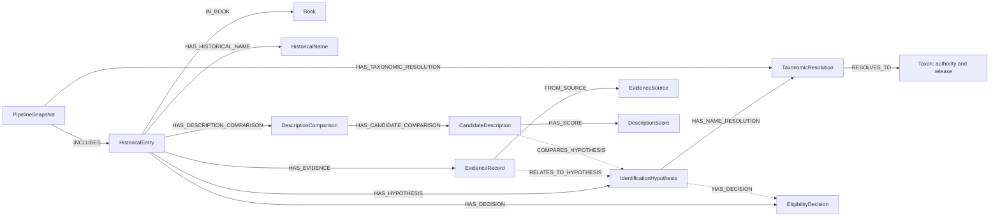

# EthnoTrace Neo4j initialization

For the current structured three-book graph and snapshot-aware import process, start with [STRUCTURED.md](STRUCTURED.md). The sections below also document the original graph importer; references to two-book inputs or older limitations may predate the Shennong extension. Filter queries by `snapshot_id` when multiple snapshots coexist.

This is an initial implementation for Neo4j 5.x. It represents existing pipeline outputs, including hidden candidates, without asserting that an accepted scientific name is the historically correct plant. The schema supports botanical data, existing historical claims, MeSH mappings, and the saved shared Stage 3 assessments. Imported outputs remain research hypotheses and assessments, not independently verified medical findings. See [MODEL.md](MODEL.md).

## Graph structure



Dotted links are created only when a unique match exists. `RELATES_TO_HYPOTHESIS` means a record has the same normalized node as a hypothesis; it is **not** a claim that the record proves the historical identification. Taxonomic resolutions retain WFO, WCVP and Global Names assertions separately as JSON, including disagreements. When an accepted authority ID and release are present, WFO and WCVP resolutions point to separate authority-qualified Taxon nodes. Identical names never merge taxon records. Description comparisons retain their original result JSON and expose candidate-level scores and historical quotations as queryable records; their scores are not independent facts. `raw_json` properties retain the source records, including original names, quotations, IDs, provenance, and diagnostic fields. The original files remain the authoritative source of record.

Every entry, hypothesis, evidence row and decision is scoped to a `PipelineSnapshot`. Its ID hashes the input files and `prepare.py`; a changed input or preparation script produces a separate snapshot. Books are scoped to snapshots so edition metadata does not overwrite older snapshots; source labels and authority-qualified taxon IDs are shared. IDs for candidate and decision rows depend on their source order and are valid within the snapshot only. Names are not used to merge taxa across sources or books. Historical text and all A/B/X decisions are imported. An unresolved decision is linked only when its generated unresolved label matches uniquely; otherwise it remains attached to its entry with a link status.

## 1. Initialize the schema

With a Neo4j 5.x database running and `cypher-shell` installed, set `NEO4J_URI`, `NEO4J_USER`, `NEO4J_DATABASE`, and `NEO4J_PASSWORD` in your shell, then run from the repository root (or run each statement in `01_schema.cypher` in Neo4j Browser):

```sh
cypher-shell -a "$NEO4J_URI" -u "$NEO4J_USER" -d "$NEO4J_DATABASE" < neo4j/01_schema.cypher
```

The account needs permission to create constraints and indexes. `IF NOT EXISTS` makes repeated initialization safe when equivalent schema already exists; it does not resolve pre-existing conflicts. Uniqueness constraints do not enforce the presence of IDs for arbitrary external writers, so importers must always supply them. [Neo4j constraint documentation](https://neo4j.com/docs/cypher-manual/5/constraints/create-constraints/).

## 2. Prepare data without connecting to Neo4j

```sh
python3.10 -B neo4j/prepare.py --output /tmp/ethnotrace-snapshot.jsonl
```

Choose a new output path: preparation refuses to overwrite an existing file. The loader now requires version 2 snapshots: regenerate older exports before loading. Existing database snapshots are not modified automatically. Both books' tracked results and the scientific-name outputs described in `MISSING_FILES.md` are required. The description-check files are optional and their absence is reflected in the input manifest. Preparation prints counts, a snapshot ID, and the number of unmatched or ambiguous links. Many common-name source rows have no normalized candidate: they remain attached to their historical entry but cannot be linked to a hypothesis. Do not infer an identification from those rows.

**The existing pipeline has known reliability defects.** Preparation faithfully exports its current outputs; it does not fix or validate them. Review a snapshot before using its A/B/X decisions as research findings.

## 3. Load a reviewed snapshot

The isolated `neo4j/.venv` environment contains the tested Neo4j driver. If you need to recreate it, run `python3.10 -m venv neo4j/.venv` followed by `neo4j/.venv/bin/python -m pip install neo4j==5.28.8`. Set your connection details; the loader prompts for the password if `NEO4J_PASSWORD` is not set. Do not commit credentials.

```sh
export NEO4J_URI='neo4j://localhost:7687'
export NEO4J_USER='neo4j'
export NEO4J_DATABASE='neo4j'
neo4j/.venv/bin/python -B neo4j/load.py /tmp/ethnotrace-snapshot.jsonl
```

`--uri`, `--user`, `--database`, and `--batch-size` can override defaults. Run the schema first. The loader rejects missing or duplicate IDs, missing endpoints, cross-snapshot links and authority mismatches before connecting. The loader uses parameterized Cypher and `MERGE` on constrained IDs. Re-importing the same prepared file does not intentionally duplicate nodes or relationships. Different snapshots coexist. Each batch commits independently: if a load fails, fix the cause and rerun the same file; do not interpret a partial snapshot as complete. Use a database you intend to populate.

## 4. Inspect the data

`02_queries.cypher` contains read-only examples. Set the `snapshot_id`, `book_id`, and `entry_key` parameters in your client. For example, `book_id` is `culpeper` and `entry_key` can be `amara-dulcis`. Inspect unlinked evidence and decisions as well as the A/B/X candidates.

The model intentionally avoids `SAME_AS` relationships or a cross-book `Taxon` identity inferred from spelling. Cross-book candidates can share a Taxon only through the same authority ID and release. Reconciliation across authorities and snapshots requires explicit provenance and reviewed crosswalks. A Neo4j constraint enforces uniqueness of graph IDs, not the scientific validity of the data.

## Ontology and future claims

[MODEL.md](MODEL.md) defines display fields, evidence interpretation, IDs, snapshot boundaries and the proposed claim/study records. [03_claims_and_studies.cypher](03_claims_and_studies.cypher) supplies optional parameterized templates for use only after real source formats and data have been verified; it does not create placeholder findings. The `load_claims.py` importer handles the existing claims and shared Stage 3 outputs as described below.

## Load the existing historical claims and shared Stage 3 outputs

The current checkout includes `claims/` and `stage3/` data. After loading a version 2 botanical snapshot, validate the additional inputs without connecting:

```sh
python3.10 -B neo4j/load_claims.py /path/to/snapshot.jsonl --dry-run
```

Then, with the same Neo4j environment variables and official Python driver configured:

```sh
neo4j/.venv/bin/python -B neo4j/load_claims.py /path/to/snapshot.jsonl
```

This imports the existing claims, MeSH mappings and inferred shared-group records, plus the **shared** Stage 3 units, source records, assessments and their recorded excerpts. It does not run the model, retrieve studies, or infer medical efficacy. Claims with no currently linked plant are retained. A unit links to a plant hypothesis only by a unique WFO ID for the same historical entry; unmatched or ambiguous units remain unlinked. `DatasetImport` records input hashes and is linked to its botanical snapshot. Shared groupings remain inference records and do not establish remedy equivalence.

`04_display_queries.cypher` contains read-only examples for Neo4j Browser. Each prepared claim-and-study import is versioned by its source-file hashes and loader version: re-import the same files to avoid duplicate records. Changes to the botanical snapshot, input data or importer produce another dataset. Always use the snapshot/dataset IDs when comparing versions.

**Scientific review:** Stage 3 assessments are imported as recorded, including review status and raw provenance; they are not independently verified by this database import. The prior audit found unresolved LSJ citation/sense issues and description comparisons with only `absent` data that can be described as poor matches. Resolve or display those limitations before presenting an identification or study assessment as verified.

## Open Neo4j Browser

Open `http://127.0.0.1:7474` in your browser, sign in with your Neo4j credentials, and select the `ethnotrace` database. Run the examples in [04_display_queries.cypher](04_display_queries.cypher) one at a time. The botanical snapshot and the claim/study dataset are separate, so use their IDs when querying multiple versions.

## Full claim–plant unit source files

After loading the shared claims dataset, run `neo4j/.venv/bin/python -B neo4j/load_full_units.py /path/to/snapshot.jsonl` using the same connection environment. The optional `--dry-run` validates inputs without connecting. This creates a separately versioned `DatasetImport` containing `FullUnitRecord` nodes for each line in both full unit files. Source path and line number distinguish records when a `unit_id` is reused for different plants. Original records are preserved in `raw_json`; claim links are explicit, and hypothesis links require a unique matching authority ID within the entry. Shared-unit links are made only for an unambiguous source ID and matching authority ID. A full source record may represent the same unit as a shared unit, so do not count both as separate claims or assessments.

The shared assessment import does not establish that every full-unit record has been assessed. Other Stage 3 runs, caches, and complete source documents are not loaded by this importer. When multiple snapshots or datasets coexist, filter on the relevant `dataset_id` or `snapshot_id` rather than summing all versions together.
