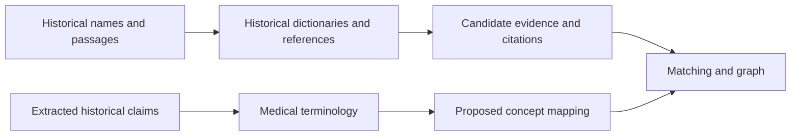

# Historical and medical reference sources

This folder provides reference material used to **find and contextualize** historical names or map extracted claims to medical terminology. A dictionary entry or terminology match is supporting evidence, not a validated botanical or clinical conclusion.

## Sources in this folder

| Source | Use in the project | Guide |
| --- | --- | --- |
| **LSJ** | Greek dictionary evidence and citations relevant to historical-name lookup. | [lsj/](lsj/README.md) |
| **Lewis & Short** | Latin dictionary evidence for name lookups. | [lewis_short/](lewis_short/README.md) |
| **Bretschneider** | Historical reference material used when investigating Shennong candidate identities. | [bretschneider/](bretschneider/README.md) |
| **MeSH** | Medical Subject Headings used for proposed concept mappings and research retrieval. | [mesh/](mesh/README.md) |

A citation to another passage or an ambiguous dictionary sense must not be treated automatically as identification of the current entry. Historical and medical terms may not map exactly to modern concepts; mappings can be approximate or absent.

See [matching](../matching/README.md), [claims](../claims/README.md), [DATA_SOURCES.md](../DATA_SOURCES.md) and [MISSING_FILES.md](../MISSING_FILES.md) for how references are used, source licences, versions and separately distributed material.
