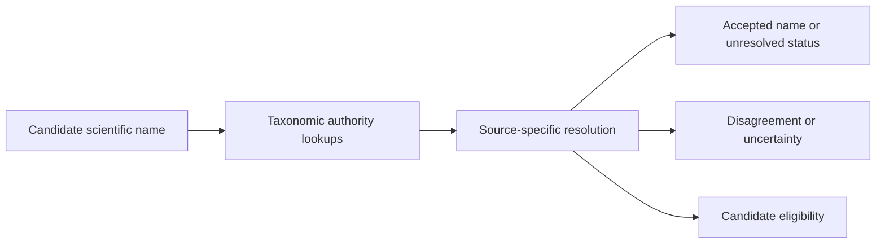

# Scientific-name sources · Taxonomic reconciliation

These providers help answer **how a candidate scientific name is treated by a taxonomic authority**. They do not answer whether the candidate is the correct historical plant. Authority records may disagree, and original names and provenance remain important.

## Sources

| Source | Project role |
| --- | --- |
| [World Flora Online](wfo/README.md) | Plant-name and taxonomic resolution data. |
| [WCVP](wcvp/README.md) | World Checklist of Vascular Plants name and status data. |
| [Global Names](globalnames/README.md) | Name verification across recorded sources. |
| [IPNI](ipni/README.md) | Nomenclatural reference information. |

[matching/resolve_scientific.py](../matching/resolve_scientific.py) consumes available provider outputs and records candidate-level resolutions. Outputs and identifiers retain authority context; identical name strings alone should not be used to merge taxa. See [matching](../matching/README.md) for downstream decisions and [DATA_SOURCES.md](../DATA_SOURCES.md) for versions and source terms.

## Reproducibility

Some large authority datasets, lookups and caches are not committed to Git. Consult [MISSING_FILES.md](../MISSING_FILES.md) before rebuilding. Never infer scientific validity from a successful lookup or equate taxonomic acceptance with historical identification.
