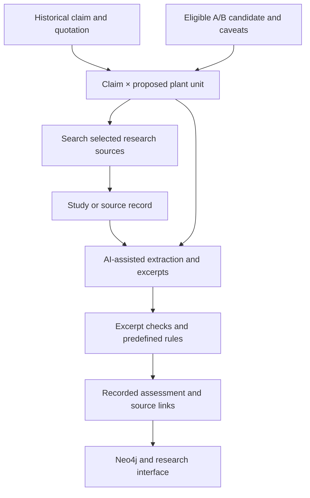

# Stage 3 · Modern research assessments

This stage asks how selected modern research **relates to a recorded historical claim and a proposed plant**. It saves source records, model-assisted extractions and rule-based assessments. It does not prove a remedy works or replace an expert review of a study.

[Main project](../README.md) · [Evidence rules](EVIDENCE_RULES.md) · [Review status](review/README.md) · [Missing inputs](../MISSING_FILES.md)

## From a claim to an assessment

1. **Build units.** [build_units.py](build_units.py) associates selected historical claims with proposed A/B plants. A unit retains the uncertainty of the candidate; it is not a confirmed species identification.
2. **Retrieve sources.** [retrieve.py](retrieve.py) searches selected combinations using available plant names and concepts. Sources include PubMed, Europe PMC, ClinicalTrials.gov and EMA herbal monographs; coverage, limits and retrieval lanes are described in [EVIDENCE_RULES.md](EVIDENCE_RULES.md).
3. **Extract facts.** [extract_assessments.py](extract_assessments.py) prepares and imports AI-assisted information, such as compatibility, outcomes and excerpts. Code checks recorded excerpts against available source text; a quote match does not guarantee the interpretation is correct.
4. **Apply rules.** [rules.py](rules.py) uses extracted information and predefined criteria to record applicability and findings. Unknown or mismatched information limits the strength of a connection. The rule output depends on the quality of the extracted inputs.
5. **Preserve results.** [units](units/README.md), [studies](studies/README.md), [assessments](assessments/README.md), and [graph exports](graph/README.md) keep the outputs of selected runs. The graph can link an assessment to its claim unit and source study.

## What an assessment can and cannot tell you

Research types are kept distinct: a laboratory or animal result is preclinical, a trial registration may have no results, and an EMA traditional-use record is not automatically evidence of clinical efficacy. Different species, conditions, plant parts, preparations or routes can make a comparison indirect. A missing source does not establish that no research exists. See the full [evidence rules and limits](EVIDENCE_RULES.md).

## Review and reproducibility

The [pilot review](review/README.md) is provisional and is **not validated human review**. Later prompt batches were not tested against the pilot batch size, and repeated runs were not performed as an ablation. Human expertise is needed to evaluate claims, study interpretations and clinical significance.

**Review-status provenance:** In the saved `shared` and `shennong` assessment JSONL files, 27 records have a top-level status saying “facts corrected by a person” while their correction notes identify Claude-only review. The graph importer converts the display status for this pattern to “AI only; not checked by a person” while retaining source provenance. See [load_claims.py](../neo4j/load_claims.py) and [structured graph documentation](../neo4j/STRUCTURED.md). Do not interpret the original status as verified human review.

Some inputs, prompts, model replies, source texts and caches are distributed separately; see [MISSING_FILES.md](../MISSING_FILES.md). The [data contract](STAGE3_DATA_CONTRACT.md) is a historical draft; consult current code and [EVIDENCE_RULES.md](EVIDENCE_RULES.md) for the implemented workflow. Re-running model-based steps may not reproduce the same output.
